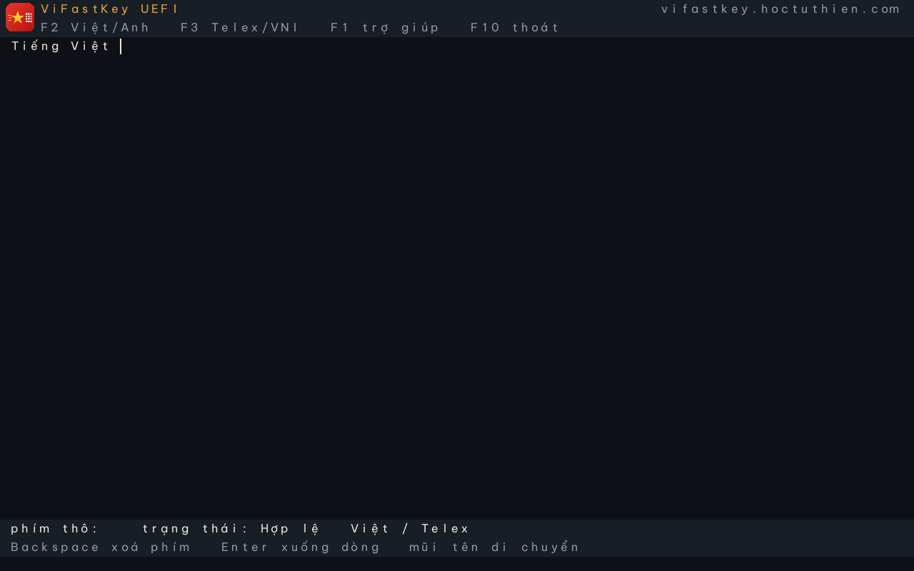

# ViFastKey UEFI — bản demo

Ứng dụng UEFI x86_64 tối giản: một trình soạn thảo nhỏ chạy trước khi OS boot, gõ tiếng Việt bằng
Telex/VNI và hiển thị bằng GOP + font nhúng.



Ảnh chụp sẵn để đăng bài:

- `docs/screenshot-main.png` — editor với logo/URL.
- `docs/screenshot-help.png` — help + QR trang chủ.

> Đây là **demo app tự chứa**, không phải IME toàn hệ thống. Nó không gõ được vào UEFI Setup
> hay các app UEFI khác; muốn làm vậy phải hook `ConIn`, rất dễ vỡ và không portable.

## Tính năng

- Telex: `tieengs` → `tiếng`, `thuowng` → `thương`, `dd` → `đ`.
- VNI: `Vie65t` → `Việt`.
- Gõ tiếng Anh (escape): gõ `text` rồi cách/Enter sẽ giữ `text`.
- Preedit gạch chân, con trỏ, Backspace theo phím thô, Enter, mũi tên, Home/End, Delete.
- `F2` bật/tắt tiếng Việt, `F3` Telex/VNI, `F1` trợ giúp (F1 lần nữa/Esc để đóng), `F10` thoát.
- Logo ViFastKey ở header, URL `key.vifast.org`; `F1` có QR trang chủ để quét bằng điện thoại.
- Hiển thị bằng GOP + font bitmap sinh từ Be Vietnam Pro; không phụ thuộc font console của firmware.
- Dùng lại `vfk-core`/`vi-syllable` ở chế độ `no_std + alloc`; không fork engine.

## Biên dịch

Yêu cầu Rust stable có target UEFI:

```bash
rustup target add x86_64-unknown-uefi
./tools/build.sh
```

Kết quả: `build/esp/EFI/BOOT/BOOTX64.EFI`.

Đóng gói để phát hành (ZIP giải nén trực tiếp vào USB):

```bash
./package.sh
# dist/vifastkey-uefi-x86_64.zip
```

## Chạy bằng QEMU

macOS (Homebrew):

```bash
brew install qemu
./tools/run-qemu.sh
```

Linux: đặt `OVMF_CODE`/`OVMF_VARS_SRC` nếu firmware không nằm ở đường dẫn mặc định, ví dụ:

```bash
OVMF_CODE=/usr/share/OVMF/OVMF_CODE.fd \
OVMF_VARS_SRC=/usr/share/OVMF/OVMF_VARS.fd \
./tools/run-qemu.sh
```

`F10` trả về boot menu của firmware (QEMU vẫn chạy). Đóng cửa sổ QEMU hoặc `Ctrl+C` để thoát.

## Chạy trên máy thật

1. Định dạng USB FAT32.
2. Chép `BOOTX64.EFI` vào `\EFI\BOOT\BOOTX64.EFI`.
3. Tắt Secure Boot, hoặc ký file bằng key riêng và enroll cert.
4. Khởi động từ USB. Đây là app boot-services; không ghi NVRAM, không sửa ổ đĩa.

Lưu ý: firmware phải là x86_64 UEFI. Máy chỉ có IA32 UEFI sẽ không chạy target này.

## Cấu trúc

```
uefi/
├── build.rs          # rasterize font -> OUT_DIR/vietnamese_font.bin
├── src/main.rs       # entry, ConIn loop
├── src/editor.rs     # line buffer + Composer
├── src/font.rs       # đọc font atlas, binary search glyph
├── src/render.rs     # GOP back buffer + Blt
├── docs/demo.png
└── tools/            # build + QEMU
```

`uefi/` là workspace riêng để tránh feature unification với `rust/`. Nó depends vào
`../rust/crates/vfk-core` với `default-features = false`; core chỉ compile `rules` + `transform`,
không kéo `charset`, `emoji`, `serde_json` hay `std`.

## Giới hạn

- Bàn phím giả định layout US; firmware trả `UnicodeChar` theo layout của nó.
- Chỉ Unicode precomposed; không hỗ trợ combining marks/emoji.
- Chưa có macro, gợi ý từ, charset legacy, file cấu hình, replace mode.
- Chưa ký Secure Boot; chưa test trên nhiều firmware thật.
- Font atlas sinh lúc build, cần `resources/fonts/BeVietnamPro-Regular.ttf` (OFL).

## Kiểm tra

- Self-test trong UEFI (tự build, boot QEMU, kiểm tra kết quả engine qua debugcon):
  ```bash
  ./tools/test.sh
  ```
- UI smoke test (boot QEMU, gõ thử, chụp màn hình và kiểm tra GOP):
  ```bash
  ./tools/test-ui.sh
  ```
- Core/host: `cd ../rust && cargo test --workspace`.
- Kiểm tra `no_std`:
  ```bash
  cd ../rust
  cargo test -p vfk-core --no-default-features
  cargo test -p vi-syllable --no-default-features
  cargo check -p vfk-core --no-default-features --target x86_64-unknown-uefi
  ```
- QEMU E2E: dùng monitor `sendkey` để gõ chuỗi Telex/VNI rồi `screendump`.
  ```bash
  ./tools/run-qemu.sh -display none \
      -monitor unix:build/monitor.sock,server=on,wait=off &
  python3 tools/sendkeys.py build/monitor.sock \
      --shot build/typing.ppm shift-t i e e n g s spc shift-v i e e j t
  ```
  Ảnh PPM có thể đổi bằng `sips -s format png ...` trên macOS.

## Giấy phép

Code trong thư mục này theo MIT hoặc Apache-2.0, tuỳ chọn (cùng repo, xem `LICENSE-MIT` / `LICENSE-APACHE`). Font Be Vietnam Pro dùng SIL OFL 1.1:
`../resources/fonts/BeVietnamPro-OFL.txt`. Dependency: `uefi-rs` (MIT/Apache-2.0),
`fontdue` (MIT/Apache-2.0/Zlib), `spin` (MIT), `image` (MIT/Apache-2.0),
`qrcodegen` (MIT).
